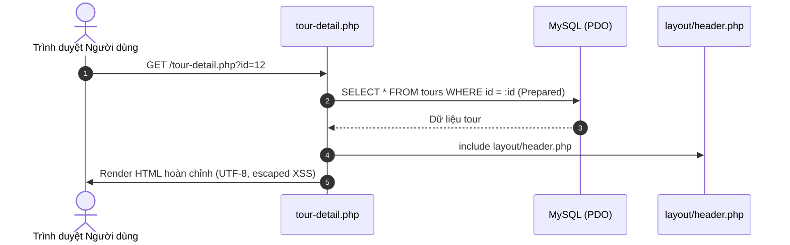

## 👁️ Quy trình Trực quan hóa Kiến trúc & Dữ liệu

Chuyển đổi logic xử lý, luồng dữ liệu và quan hệ CSDL trừu tượng thành sơ đồ trực quan dễ hiểu bằng Mermaid Markdown.

### 1. Phân tích Luồng Dữ liệu & Cấu trúc
- **Execution role**: `orchestrator` hoặc `backend-specialist` / `frontend-specialist`
- Xác định phạm vi cần vẽ: Luồng request-response của trang PHP, quan hệ các bảng trong MySQL, luồng xử lý form submit, hoặc phân quyền admin.

### 2. Xây dựng Sơ đồ Mermaid
- **Execution role**: `orchestrator`
- Tạo sơ đồ trực tiếp bằng cú pháp Mermaid nhúng trong khối markdown:
  - **Flowchart**: Minh họa luồng điều hướng (ví dụ: `index.php` -> kiểm tra route -> truy vấn PDO -> nạp `layout/header.php` -> render HTML).
  - **Sequence Diagram**: Minh họa luồng xác thực session admin hoặc luồng submit form liên hệ gửi email.
  - **Entity Relationship Diagram (ERD)**: Minh họa cấu trúc các bảng MySQL (`tours`, `categories`, `users`, `bookings`).

### 3. Giải thích Kỹ thuật & Bối cảnh
- **Execution role**: `verifier`
- Bổ sung chú thích ngắn gọn giải thích các khối chính trong sơ đồ, các điểm rẽ nhánh và điều kiện biên.
- Nhúng sơ đồ vào tài liệu kỹ thuật hoặc `walkthrough.md`.

---

## Ví dụ Sơ đồ Luồng Request PHP:

