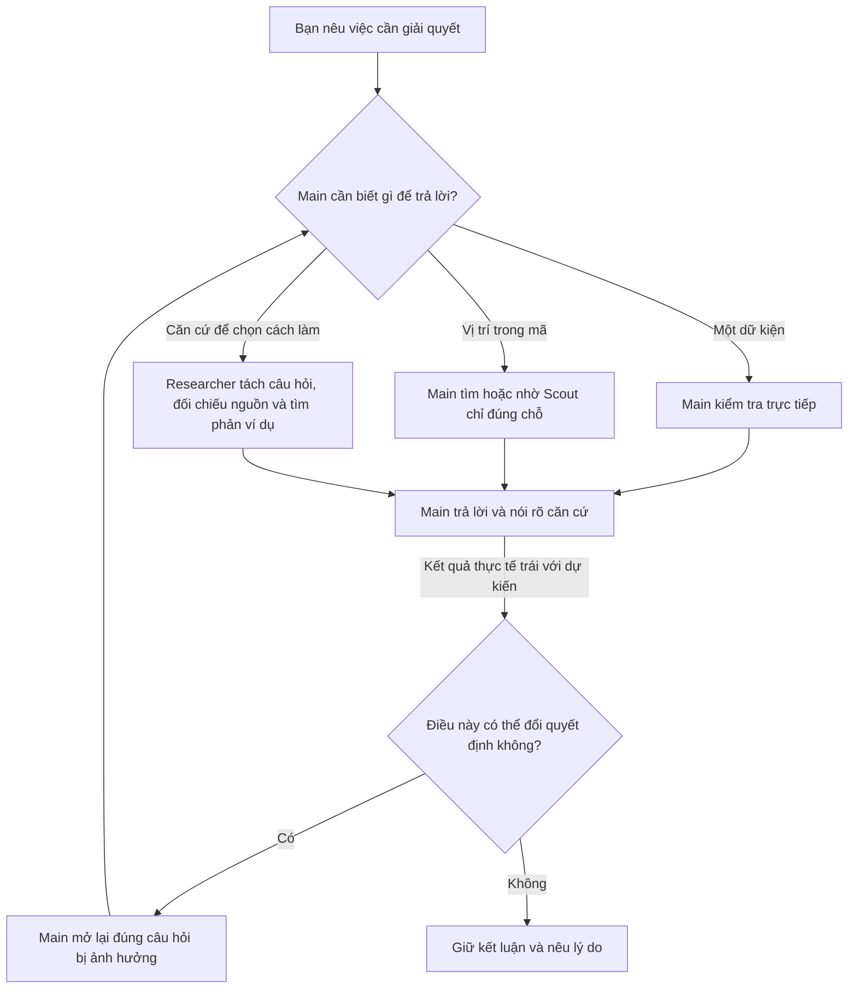

# NguyenTD Agent Kit

Bộ kit giúp trợ lý lập trình biết khi nào nên trả lời ngay và khi nào cần tìm bằng chứng trước khi đề xuất thay đổi.
Bạn nói chuyện với một đầu mối là **Main** bằng lời bình thường, không cần nhớ tên các chế độ hay tự chia việc cho từng trợ lý.

## Từ câu hỏi đến quyết định



Ví dụ, bạn hỏi: *“Trang đơn hàng mở chậm. Có nên thêm bộ nhớ đệm không?”*
Thay vì mặc định đề xuất cache, Researcher cần tách hai câu hỏi: **thời gian đang mất ở đâu**, và **dữ liệu có được phép hiển thị chậm sau khi đơn hàng thay đổi không**?
Nếu sau đó bạn cho biết nhân viên vừa sửa đơn nhưng vẫn thấy trạng thái cũ, Main có lý do xem lại đề xuất cache mà không cần làm lại phần điều tra độ trễ.

Thông thường, nghiên cứu vận hành theo **3 nhịp liên hồi**: định hình trước khi làm (`FOCUSED` trong cửa sổ ngữ cảnh riêng của `Researcher`), vi-nghiên cứu có trần (`MICRO` tối đa 3 bước qua đồ thị mã nguồn `lsp` và tài liệu gốc `context7`) ngay khi thực thi lộ điểm lệch giả định hoặc điểm nghẽn hiệu năng, và hội tụ bằng bằng chứng ngoại sinh trước khi bàn giao.
Các quyết định kỹ thuật cục bộ và chi tiết khả nghịch (Vùng Xanh / Vùng Vàng) được tự nghiên cứu và tự chốt kèm bảng tóm tắt ngắn; chỉ các quyết định kiến trúc nghiệp vụ một chiều (Vùng Đỏ) mới đưa vào `Hộp thư Quyết định` (treo riêng nhánh bị vướng, tiếp tục chạy các nhánh độc lập khác).
Chỉ khi bạn yêu cầu nghiên cứu sâu hoặc quy trình dự án cho phép rõ ràng, Main mới chia các câu hỏi độc lập cho nhiều `Researcher` và chốt trước giới hạn tìm kiếm.
Researcher chỉ đọc và trả lời kèm nguồn; Main chịu trách nhiệm về khuyến nghị cuối cùng.
Nếu cùng một sai sót lặp lại ở nhiều việc, Main có thể đề xuất cải tiến cách làm và cách đánh giá; bộ kit không tự chạy nghiên cứu nền hay tự sửa quy tắc.

## Cài vào dự án

Bạn cần Git và Node.js. Tải kit vào một thư mục riêng, rồi **chạy lệnh cài từ thư mục dự án muốn sử dụng**:

```bash
git clone https://github.com/dinhnguyen2k/nguyentd-agent-kit.git ~/nguyentd-agent-kit
cd /duong/dan/toi/du-an
node ~/nguyentd-agent-kit/bin/install.js --core
```

`--core` thêm hướng dẫn phối hợp, cách nghiên cứu và các tệp cấu hình để công cụ của bạn đọc được những hướng dẫn đó.
Nếu dự án đã có `AGENTS.md` hoặc một tệp hướng dẫn tương tự và bộ cài báo xung đột, giữ nội dung của dự án rồi thêm dòng sau vào tệp được báo:

```markdown
Đọc `.agent-core/team.md` để biết khi nào giao việc cho Researcher.
```

Mở **phiên làm việc mới** sau khi cài.
Bạn có thể bắt đầu bằng chính câu hỏi về trang đơn hàng ở trên; không cần lệnh riêng để gọi Researcher.

## Cài đầy đủ cho Cogain trên máy mới

Clone Cogain và bộ kit vào máy mới. Từ thư mục gốc của Cogain, chạy:

```bash
node ~/nguyentd-agent-kit/bin/install.js
```

Lệnh này thêm quy tắc, kỹ năng và cấu hình OMP gồm model, hook, giám sát và các trợ lý chuyên môn. Sau đó kết nối các công cụ:

```bash
bash .agent/scripts/install-harness-wiring.sh
```

Khai báo tài khoản OpenAI của bạn trong `auth.accountPolicies` tại `~/.omp/agent/config.yml`; bộ kit công khai không chứa thông tin tài khoản cá nhân. Chẩn đoán C# cần `csharp-ls` tại `~/.dotnet10/tools/csharp-ls` và .NET tại `/usr/lib/dotnet`, như khai báo trong `.agent/harness/omp/lsp.json`; nếu đường dẫn trên máy khác, hãy chỉnh tệp đó. Cuối cùng, mở một phiên OMP mới. Bộ cài không ghi đè các tệp đã có, vì vậy trên máy có bản cũ, hãy tự so sánh và thay các tệp xung đột.

## Khi cập nhật hoặc đổi công cụ

- **Cập nhật bản đã cài:** Lấy bản kit mới rồi chạy lại lệnh `--core` từ dự án. Bộ cài chỉ thêm tệp còn thiếu và bỏ qua tệp giống hệt. Nếu tệp đã có nội dung khác hoặc liên kết trỏ tới nơi khác, bộ cài báo lỗi và vẫn xử lý các mục độc lập còn lại. Hãy so sánh rồi chọn phần muốn giữ; chạy lại lệnh không tự ghi đè bản cũ.
- **Quyền truy cập:** Kit không tự cấp quyền đọc máy, chạy lệnh hay lên mạng. Claude Code và OMP dùng công cụ được cấp; AGY phụ thuộc quyền đọc của phiên; Codex dùng công cụ từ phiên cha. Với Gemini CLI, đừng mặc định rằng công cụ sẽ tự nhận cấu hình Researcher.
- **Quy tắc riêng:** Giữ dữ liệu, cấu hình máy và chính sách nội bộ trong dự án. Nếu muốn xem hoặc đề xuất sửa phần dùng chung, bắt đầu từ [cách phối hợp](core/.agent-core/team.md) và [cách nghiên cứu](.agent/skills/research/SKILL.md).
